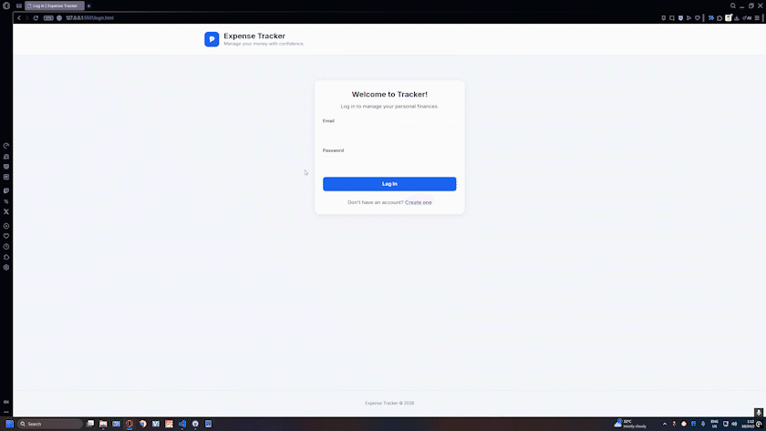

# Personal Finance REST API — Backend

A REST API for tracking personal income and expenses, built with **Python** and **Flask**. Users register and log in to get a JSON Web Token (JWT), then create, read, update, and delete their own transactions. It is the backend for the [Expense Tracker frontend](https://github.com/bmarkjan-stack/p2-expense-tracker#readme).



---

## Table of Contents

- [Features](#features)
- [Technologies](#technologies)
- [Getting Started](#getting-started)
- [Configuration](#configuration)
- [API Reference](#api-reference)
- [Data Model and Validation](#data-model-and-validation)
- [Running Tests](#running-tests)
- [Project Structure](#project-structure)
- [Known Limitations](#known-limitations)
- [License](#license)

---

## Features

- User registration and login
- JWT authentication: protected routes require a bearer token
- Create, list, read, update, and delete transactions
- Each user sees and changes only their own transactions
- Input validation with field-level error messages
- JSON responses with appropriate HTTP status codes
- SQLite database through SQLAlchemy (Flask-SQLAlchemy)
- CORS enabled, so the frontend can call the API from the browser
- Automated tests with pytest

---

## Technologies

- Python
- Flask 3.1.1 with blueprints
- Flask-SQLAlchemy 3.1.1 (SQLite by default)
- Flask-JWT-Extended 4.7.1
- Flask-CORS 6.0.1
- python-dotenv for environment variables
- Werkzeug password hashing
- pytest 8.4.1

All versions are pinned in `requirements.txt`.

---

## Getting Started

**Requirements:** Python 3 and pip.

```bash
git clone https://github.com/bmarkjan-stack/p6-personal-finance-REST-API.git
cd p6-personal-finance-REST-API

python -m venv venv
source venv/bin/activate        # Windows: venv\Scripts\activate
pip install -r requirements.txt

cp .env.example .env            # Windows: copy .env.example .env
python run.py
```

The API starts at `http://127.0.0.1:5000`. Check that it's running:

```bash
curl http://127.0.0.1:5000/api/health
```

The database file is created automatically on first start, with its tables.

---

## Configuration

Settings are read from environment variables, or from a `.env` file in the project root (loaded with python-dotenv).

| Variable | Default | Purpose |
| --- | --- | --- |
| `SECRET_KEY` | `development-secret-key` | Flask's secret key |
| `JWT_SECRET_KEY` | `development-jwt-secret` | Signs the JWTs |
| `DATABASE_URL` | `sqlite:///finance.db` | Database connection string |

> **Change `SECRET_KEY` and `JWT_SECRET_KEY` before deploying.** The defaults are public, so anyone who knows them can forge tokens.

Access tokens expire after **1 hour**.

---

## API Reference

All responses are JSON. Routes under `/api/transactions` require the header `Authorization: Bearer <access_token>`.

### Health

| Method | Path | Description |
| --- | --- | --- |
| `GET` | `/` | Returns a welcome message |
| `GET` | `/api/health` | Returns a status check |

### Authentication

| Method | Path | Success | Errors |
| --- | --- | --- | --- |
| `POST` | `/api/auth/register` | `201` | `400` invalid data, `409` username or email already in use |
| `POST` | `/api/auth/login` | `200` with `access_token` and `user` | `400` invalid request, `401` wrong email or password |

**Register** request body:

```json
{
  "username": "jane",
  "email": "jane@example.com",
  "password": "a-strong-password"
}
```

Username must be at least 3 characters, email must contain `@`, and password must be at least 6 characters.

**Login** request body: `{ "email": "...", "password": "..." }`

The login response includes an `access_token`. Send it with later requests:

```bash
curl http://127.0.0.1:5000/api/transactions \
  -H "Authorization: Bearer <access_token>"
```

### Transactions

| Method | Path | Success | Errors |
| --- | --- | --- | --- |
| `POST` | `/api/transactions` | `201` with the created `transaction` | `400` validation failed |
| `GET` | `/api/transactions` | `200` with `count` and `transactions` | `401` missing or invalid token |
| `GET` | `/api/transactions/<id>` | `200` with the `transaction` | `404` not found |
| `PUT` | `/api/transactions/<id>` | `200` with the updated `transaction` | `400` validation failed, `404` not found |
| `DELETE` | `/api/transactions/<id>` | `200` with a message | `404` not found |

For any transaction route, `401` is returned when the token is missing, invalid, or expired.

A transaction whose ID belongs to another user returns `404`, the same as one that doesn't exist. This keeps one user's data hidden from another.

**Create** request body:

```json
{
  "description": "Groceries",
  "amount": 1500,
  "category": "Food",
  "type": "expense",
  "date": "2026-10-01"
}
```

`GET /api/transactions` returns transactions newest first, by when they were created.

### Validation errors

When a request is invalid, the API returns `400` with an `error` message and a `details` object that names each invalid field:

```json
{
  "error": "Validation failed.",
  "details": {
    "amount": "...",
    "type": "..."
  }
}
```

---

## Data Model and Validation

**User:** `id`, `username` (unique), `email` (unique), `password_hash`, `created_at`. Passwords are stored only as hashes. Deleting a user also deletes their transactions.

**Transaction:** `id`, `description`, `amount`, `category`, `type`, `date`, `created_at`, `user_id`.

| Field | Rule |
| --- | --- |
| `description` | Required, at least 2 characters, up to 255 |
| `amount` | Required, a number greater than 0 |
| `category` | Required, a string |
| `type` | Required, `income` or `expense` |
| `date` | Required, in `YYYY-MM-DD` format |

---

## Running Tests

```bash
pytest
```

The tests use an in-memory SQLite database, so your real data isn't touched. They cover:

- Creating a transaction
- Listing transactions
- Rejecting invalid transaction data with field-level errors
- Deleting a transaction

---

## Project Structure

```text
p6-personal-finance-REST-API/
├── app/
│   ├── __init__.py          # create_app(): configuration, extensions, blueprints, health routes
│   ├── config.py            # settings read from environment variables
│   ├── extensions.py       # SQLAlchemy and JWT instances
│   ├── models.py            # User and Transaction models
│   ├── routes/
│   │   ├── auth.py          # register and login
│   │   └── transactions.py  # transaction CRUD, protected by JWT
│   └── utils/
│       └── validation.py    # transaction input validation
├── tests/
│   └── test_transactions.py # pytest suite
├── .env.example             # template for environment variables
├── requirements.txt         # pinned dependencies
├── run.py                   # starts the development server
└── README.md
```

---

## Known Limitations

- **Development server only.** `run.py` starts Flask with `debug=True`. Use a production WSGI server (such as Gunicorn) and turn debug off for deployment.
- **Default secrets.** The default secret keys are for development only (see [Configuration](#configuration)).
- **No refresh tokens or logout.** Tokens can't be revoked, so a leaked token stays valid until it expires after one hour.
- **No pagination or filtering.** `GET /api/transactions` returns every transaction for the user. Filtering by month or type is done in the frontend.
- **Limited test coverage.** The tests cover transaction creation, listing, validation, and deletion. Registration, login, updating, and the user-ownership rules aren't tested yet.
- **SQLite by default.** It suits development and small personal use. Set `DATABASE_URL` to use another database.
- **No password reset or account management.**

---

## License

This project is licensed under the [MIT License](LICENSE).

---

## Author

Created by [bmarkjan-stack](https://github.com/bmarkjan-stack) as a portfolio project.